# APIForge 操作手册

## 1. 首次使用

### 1.1 登录与修改密码

1. 打开管理员提供的 APIForge 地址。本地默认地址为 `http://localhost:3000`；前后端分别启动时，访问 `http://localhost:5173`。
2. 输入用户名和密码，点击登录。首次启动时，系统自动创建 `admin` 账号，初始密码在后端启动日志中输出，请向部署人员获取。
3. 首次登录后按提示修改初始密码；也可以从右上角用户菜单进入 **修改密码**。
4. 输入原密码、新密码和确认密码。新密码至少 6 位，两次输入须一致。
5. 保存后使用新密码重新登录。

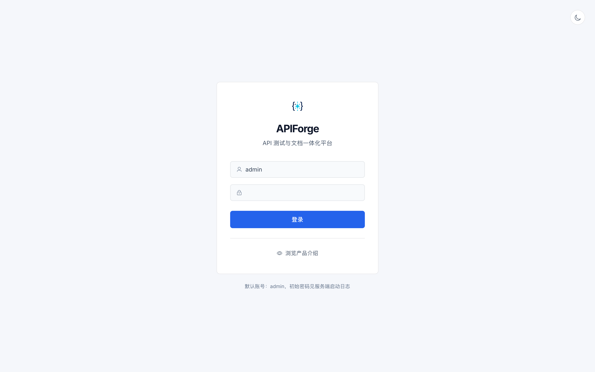

### 1.2 跑通第一轮测试

按下面的顺序操作，即可完成一轮测试并留下报告：

1. 在 **项目管理** 中创建项目并进入。
2. 在 **环境管理** 中配置被测服务的基础 URL，并激活该环境。
3. 在 **接口文档** 中导入接口，或手动创建 API。
4. 打开接口详情，点击 **调试接口**，填写参数并发送请求。
5. 调试完成后点击 **保存为测试用例**，再到 **测试用例** 检查请求和断言。
6. 在测试用例列表点击 **一键执行**，确认后运行项目全部用例。
7. 执行完成后查看自动生成的报告。

AI 配置为可选步骤；手动创建、调试和执行测试不需要开启 AI。需要 AI 分析或生成用例时，先完成第 9 节的配置。

## 2. 创建与管理项目

### 2.1 创建项目

1. 打开 **项目管理**，点击 **创建项目**。
2. 填写 **项目名称**，按需填写描述，点击 **保存**。
3. 在项目列表点击 **进入**，开始管理该项目的接口、用例和环境。
4. 切换项目后，先确认当前项目及执行环境，再执行测试。

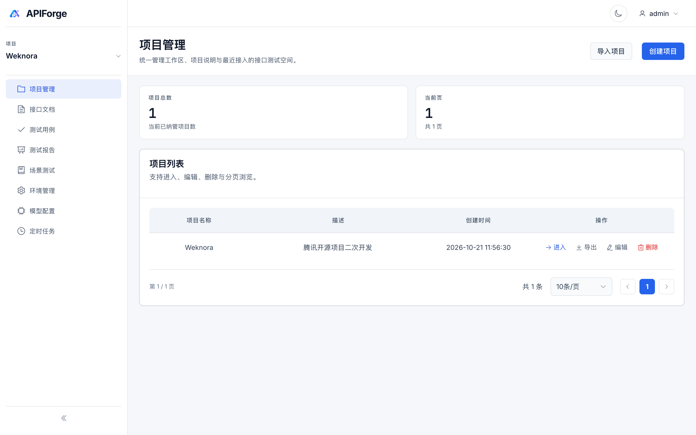

### 2.2 导出与导入项目

1. 在项目列表找到目标项目，点击 **导出**，确认后保存 JSON 文件。
2. 需要导入时，点击 **导入项目**。
3. 上传导出的 `.json` 文件，或粘贴完整 JSON 内容。
4. 点击 **导入**，完成后进入新项目，检查接口、用例、环境和场景。

项目导出包含项目基本信息、接口、测试用例、环境和场景，不包含历史报告、定时任务和 AI 模型配置。迁移后需重新检查前置用例、场景步骤等关联配置，并补充模型和定时任务设置。

修改名称或描述可使用列表中的 **编辑**。删除项目前请先导出需要保留的配置；删除项目会同时删除关联的接口、用例、场景、环境、报告和定时任务。

## 3. 配置测试环境

### 3.1 创建并激活环境

1. 进入项目，打开 **环境管理**，点击 **创建环境**。
2. 填写以下内容后保存。
3. 在列表点击 **激活**，将该环境用于后续默认执行。
4. 点击 **测试** 检查连通性，再通过具体接口调试确认业务请求可用。

| 字段 | 填写方法 | 示例 |
| --- | --- | --- |
| 环境名称 | 使用能区分部署环境的名称 | `TEST` |
| 基础 URL | 填写被测服务地址，包含协议；有统一路径前缀时一并填写 | `https://test.example.com/api` |
| 描述 | 可选，说明用途 | `测试环境` |
| 设为激活 | 开启后作为当前激活环境 | 开启 |
| 自定义变量 | 保存请求中使用的固定键值 | `userId` = `12345` |

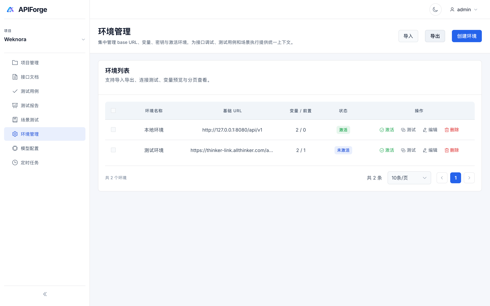

测试请求由 APIForge 后端发出，被测地址必须能从后端所在机器访问。Docker 部署时，`localhost` 指向 APIForge 容器本身；被测服务在宿主机或其他容器时，请填写后端实际可达的地址。

### 3.2 在请求中引用变量

在环境的 **自定义变量** 区域点击 **新增**，填写键和值。请求 URL、Headers、Query 和 Body 中使用 `{{变量名}}` 引用。

| 使用位置 | 示例 |
| --- | --- |
| 请求 URL | `/users/{{userId}}` |
| 请求头 | `Authorization: Bearer {{token}}` |
| Query 字段值 | `{{tenantId}}` |
| JSON Body | `{"userId":"{{userId}}"}` |

基础 URL 也可通过内置变量 `{{base_url}}` 或 `{{baseUrl}}` 引用。例如，环境基础 URL 为 `https://test.example.com/api` 时，请求 URL 可填 `/users` 或 `{{base_url}}/users`。完整的绝对 URL 会直接用于请求，切换环境时需检查它是否仍指向正确服务。

### 3.3 配置前置用例（自动登录与变量提取）

需要鉴权，或后续请求依赖其他接口产出的数据时，用 **前置用例** 在每次执行前自动准备变量。前置用例可以有多个，按顺序执行，各自提取自己的变量。

1. 先创建并调试好需要的前置用例，例如「用户登录并获取访问令牌」「获取会话列表」。
2. 点击目标环境的 **编辑**，找到 **前置用例** 区域。
3. 点击 **添加前置用例**，在下拉框中选择用例。
4. 在该步骤下点击 **添加变量**，填写变量名和 JSON 路径。例如变量名 `token`、JSON 路径 `$.data.token`。
5. 需要多个变量时继续 **添加变量**；需要多个前置用例时再次点击 **添加前置用例**。
6. 用 **上移** / **下移** 调整顺序，后一个前置用例可以使用前面已提取的变量。
7. 保存环境配置。
8. 在需要鉴权的用例 Headers 中填写：

```json
{
  "Authorization": "Bearer {{token}}"
}
```

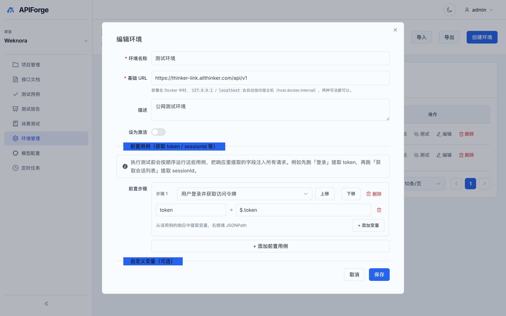

提取规则适用于以下登录响应；实际路径须按被测系统响应调整：

```json
{
  "data": {
    "token": "example-token"
  }
}
```

| 场景 | 前置用例编排 |
| --- | --- |
| 只需要 token | 步骤 1：登录用例 → 变量 `token` = `$.data.token` |
| 还需要会话 ID | 步骤 1：登录 → `token`；步骤 2：获取会话列表 → `sessionId` = `$.data[0].id` |

执行时，系统会按顺序运行这些前置用例，把提取到的变量注入所有请求。已经由自定义变量提供值的变量名会被跳过，因此不要在自定义变量中保留同名的旧 token，以免覆盖提取结果。也可在场景中显式编排登录步骤，具体见第 6 节。

前置用例失败时，测试会直接报错并说明是哪一步、返回了什么状态码，不会带着空变量继续执行。

### 3.4 导入与导出环境

在环境列表点击 **导出** 保存配置。需要恢复时点击 **导入**，粘贴导出的完整 JSON 对象或其中的 `environments` 数组，确认导入。导入后检查基础 URL、自定义变量及前置用例关联，再激活环境。

## 4. 导入与调试接口

### 4.1 导入接口文档

1. 打开 **接口文档**，点击 **导入 API**。
2. 选择 **Swagger / OpenAPI** 或 **Postman Collection**。
3. 选择数据来源：有文件时选择 **上传文件** 并选中文档；已复制文档内容时选择 **粘贴内容** 并粘贴全文。Swagger/OpenAPI 也可选择 **URL 地址** 并填写文档地址，Postman 使用文件或粘贴方式。
4. 点击 **导入**。Swagger/OpenAPI 支持 2.0、3.x，Postman 支持 Collection v2.1。
5. 导入完成后，在列表中搜索路径或摘要，打开详情核对方法、参数和响应定义。

URL 地址由服务端代为抓取，目标站点无需配置 CORS。填写 Swagger UI 页面地址（如 `/swagger-ui/index.html`）时，会自动解析到其背后的文档地址（`/v3/api-docs` 等）；若解析不到，请直接填写可返回文档内容的地址。需要登录才能访问的地址请改用粘贴或上传方式。

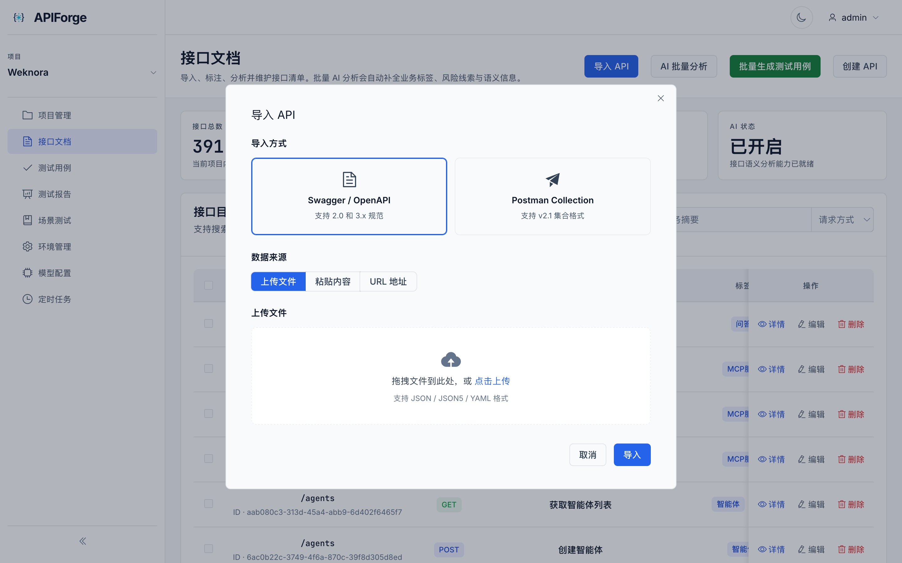

没有接口文档时，按以下步骤手动添加：

1. 点击 **创建 API**。
2. 在 **方法** 中选择接口的 HTTP 方法，例如 `GET`。
3. 在 **路径** 中填写接口路径，例如 `/users/{id}`。
4. 在 **摘要** 中填写便于识别的名称，例如“获取用户详情”，并按接口实际要求补充参数、请求体和响应定义。
5. 点击 **保存**，在接口列表搜索刚填写的路径，确认接口已出现。需要修改时，点击该行的 **编辑**。

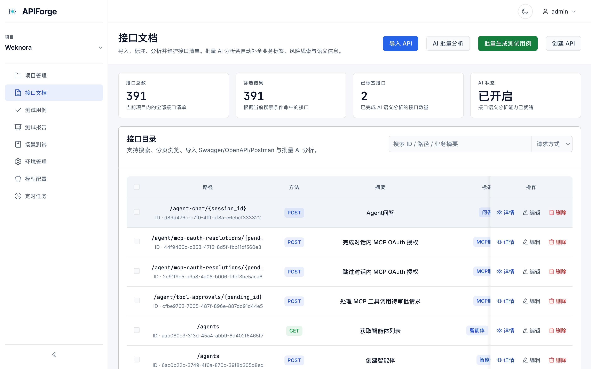

列表的 **标签** 列最多显示 3 个标签，超出的折叠为 `+N`，鼠标悬浮可查看完整列表。

### 4.2 调试单个接口

1. 在接口列表点击 **详情**。
2. 查看请求参数的位置、类型和必填要求。
3. 点击 **调试接口**，选择测试环境。
4. 检查 URL，填写请求头、Query 和 Body；路径中的占位参数需替换为实际值或已配置的变量。
5. 点击 **发送**，查看弹窗中的状态码、响应时间和响应内容。
6. 确认请求符合预期后，点击 **保存为测试用例**，再到测试用例中补充或核对断言。

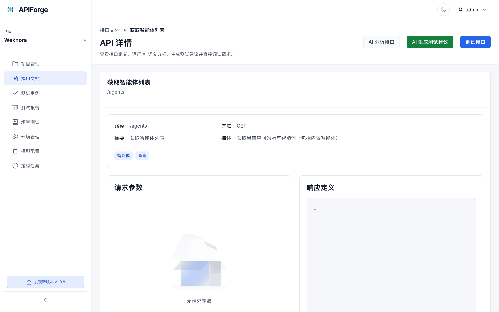

### 4.3 使用 AI 分析接口和生成用例

前提：已在 **模型配置** 中新增并启用模型，且为它勾选了对应功能。

分析单个接口：

1. 打开目标接口的 **详情**，点击 **AI 分析接口**。
2. 等待分析完成，向下查看 **AI 接口语义分析** 区域。
3. 根据业务上下文、敏感字段和推荐测试方向，检查是否还需补充异常或边界用例。

生成并保存测试建议：

1. 在接口详情点击 **AI 生成测试建议**。
2. 检查建议中的请求参数和断言，勾选要保留的建议。
3. 点击 **保存选中建议**。
4. 打开 **测试用例**，找到刚保存的用例，检查配置后执行。

批量生成用例：

1. 返回接口列表，勾选要处理的接口。
2. 点击 **批量生成测试用例**，检查弹窗列出的待生成接口。
3. 点击 **开始生成**，等待完成后进入 **测试用例** 检查生成结果。
4. 如果弹窗提示没有待生成接口，先检查所选接口是否已有用例。

批量分析接口时，在列表勾选接口后点击 **AI 批量分析**，等待完成，再打开接口详情检查分析结果。

生成后到 **测试用例** 检查实际 URL、参数、鉴权和预期值，补齐业务数据后再执行。

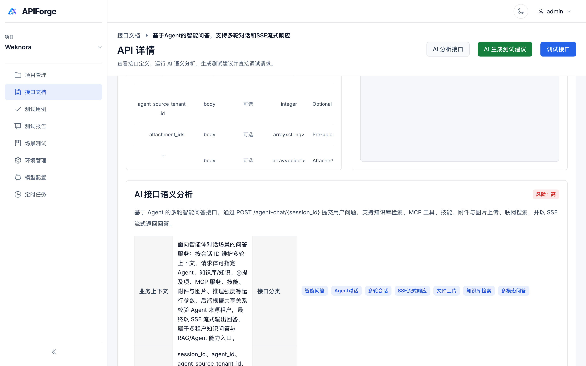

## 5. 创建与执行测试用例

### 5.1 手动创建用例

1. 打开 **测试用例**，点击 **创建测试用例**。
2. 填写用例名称和优先级，按需填写关联 API 的 ID 与描述。
3. 选择请求方法，填写请求 URL。
4. 填写 Headers、Query 和请求体。JSON 字段必须是合法 JSON；没有请求头或查询参数时可填写 `{}`。
5. 配置断言，点击 **保存**。

例如，测试获取用户信息时，可使用以下配置：

| 字段 | 示例 |
| --- | --- |
| 用例名称 | `获取用户信息成功` |
| 请求方法 | `GET` |
| 请求 URL | `/users/{{userId}}` |
| Headers (JSON) | `{"Authorization":"Bearer {{token}}"}` |
| Query (JSON) | `{}` |

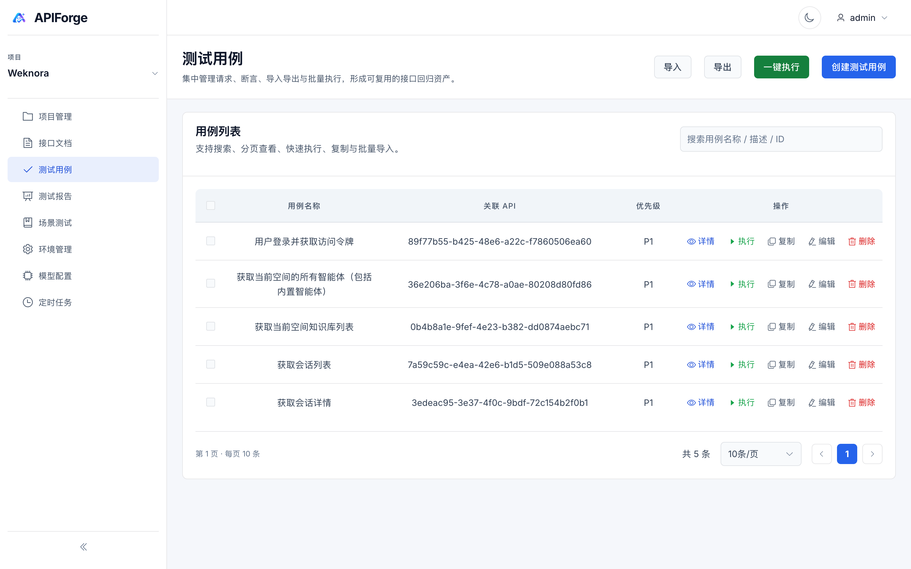

### 5.2 填写断言

断言用于判断实际响应是否符合预期。在创建或编辑用例的 **断言 (JSON)** 中填写数组，例如：

```json
[
  { "type": "STATUS", "condition": "eq", "expected": 200 },
  { "type": "JSON_PATH", "target": "$.data.id", "condition": "exists", "expected": true },
  { "type": "RESPONSE_TIME", "condition": "lt", "expected": 2000 }
]
```

这组断言要求 HTTP 状态码为 200、响应体中存在 `data.id`，且响应时间小于 2000 毫秒。

| 类型 | 检查内容 | 目标填写方法 |
| --- | --- | --- |
| `STATUS` | HTTP 状态码 | 不需要填写 `target` |
| `JSON_PATH` | 响应体中的字段 | 如 `$.code`、`$.data.id`、`$.data.items[0].id` |
| `RESPONSE_TIME` | 响应时间，单位毫秒 | 不需要填写 `target` |

常用条件有 `eq`（等于）、`neq`（不等于）、`exists`（存在）、`contains`（包含）、`gt`（大于）、`lt`（小于）和 `matches`（正则匹配）。预期值应与业务字段类型一致，例如数值 `0` 与字符串 `"0"` 应按实际响应选择。

用例详情也可以通过断言区域的 **添加** 按钮逐条添加规则。

### 5.3 执行单个用例与全部用例

执行前先到 **环境管理** 确认激活环境。用例列表的 **执行** 和 **一键执行** 默认使用激活环境；没有激活环境时会回退使用列表中的第一个环境。

执行一个用例：

1. 在列表找到目标用例，点击该行的 **执行**；也可以点击 **详情**，再点击 **执行测试**。
2. 等待执行完成，在结果区域查看请求、响应、状态码和耗时。
3. 逐条查看断言的预期值与实际值；失败时按第 11 节排查，修改后再次执行。

执行项目全部用例并生成报告：

1. 在列表顶部点击 **一键执行**。
2. 核对确认框中的用例数量，点击 **执行**。
3. 等待页面跳转到报告，检查通过率和失败用例。

**一键执行** 运行当前项目全部用例，搜索或分页不会缩小执行范围。

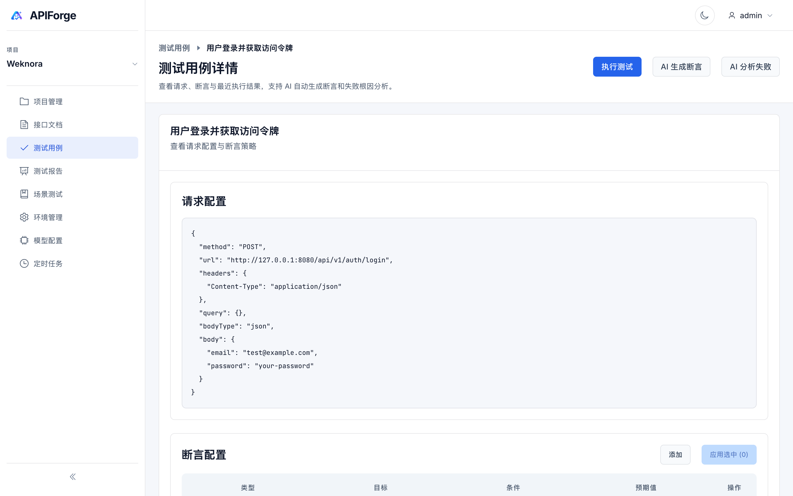

单个用例调试结果用于即时检查；需要在报告列表保留执行记录时，使用 **一键执行**，或通过场景、定时任务生成报告。

### 5.4 使用 AI 补充断言与分析失败

1. 先执行用例，获得真实响应。
2. 点击 **AI 生成断言**，查看基于最近一次响应生成的建议。
3. 勾选需要的规则，点击 **应用选中**，再重新执行验证。
4. 用例失败时，点击 **AI 分析失败** 查看原因建议，并结合实际请求、响应和失败断言定位问题。

### 5.5 复制、导入与导出用例

复制用例：

1. 找到需要复用的用例，点击该行的 **复制**。
2. 找到生成的副本，点击 **编辑**，修改名称、参数和断言。
3. 点击 **保存**，执行副本确认结果。

导出与导入用例：

1. 在列表顶部点击 **导出**，保存下载的用例文件。
2. 需要导入时，点击 **导入**，选择 JSON、CSV 或 Postman 格式。
3. 选择 **上传文件** 并选中文件，或选择 **粘贴内容** 并粘贴完整数据。上传文件大小不超过 5 MB。
4. 点击弹窗中的 **导入**，等待完成后在用例列表检查结果。

JSON 导入支持用例数组或含 `testCases` 字段的对象。CSV 表头为：

```text
name,method,url,headers,query,body,assertions,priority,apiId,description,tags
```

批量迁移时优先使用导出的文件，导入后检查请求变量及关联 API。

## 6. 编排与执行场景测试

### 6.1 创建场景与安排步骤

先创建场景需要的测试用例，再进行编排：

1. 打开 **场景测试**，点击 **创建场景**。
2. 填写场景名称和描述，按需添加场景变量。
3. 点击 **新增步骤**，为每一步选择 **关联测试用例**。
4. 用上下箭头调整步骤顺序。
5. 需要将当前响应传给后续步骤时，打开该步骤的 **提取规则**，填写变量名和 JSON 路径。
6. 只想修改本场景某一步的请求时，使用 **请求覆盖** 设置 URL、Headers、Query 或 Body。
7. 保存场景，在详情中核对步骤及变量配置。

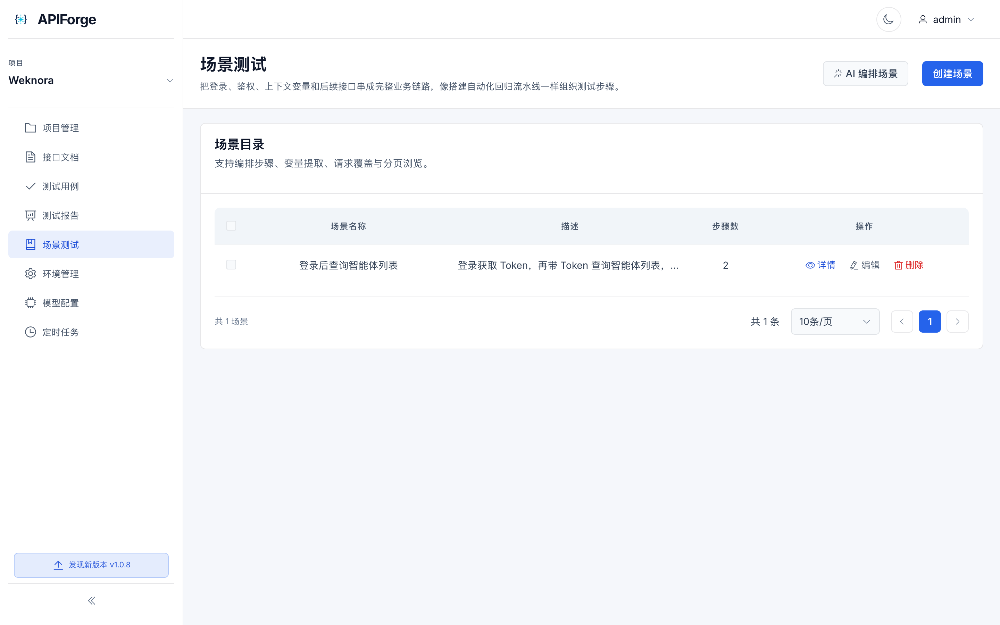

### 6.2 示例：登录后查询用户信息

准备“登录”和“查询用户信息”两个用例，按以下方式编排：

| 步骤 | 关联用例 | 配置 |
| --- | --- | --- |
| 1 | 登录 | 提取变量 `token`，JSON 路径为 `$.data.token` |
| 2 | 查询用户信息 | Headers 中填入 `{"Authorization":"Bearer {{token}}"}` |

JSON 路径从响应体根节点开始填写。若登录响应为 `{"token":"..."}`，路径应改为 `$.token`。提取的变量供后续步骤引用，因此登录步骤应放在查询步骤之前。

如果环境中已配置前置用例（例如登录），可由它提供 token；无需在场景中重复添加相同的登录步骤。

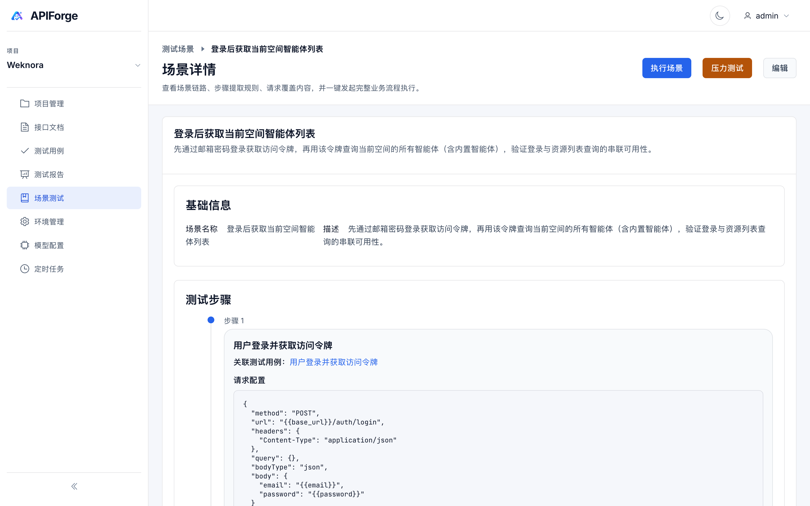

### 6.3 执行场景并保留报告

1. 打开场景详情，点击 **执行场景**。
2. 选择环境。
3. 需要保留执行记录时，开启 **生成报告**，按需填写报告名称。
4. 点击 **执行**，完成后逐步查看请求、响应、断言和提取变量。
5. 如已生成报告，到 **测试报告** 查看历史记录。

### 6.4 使用 AI 编排场景

1. 先在项目中导入相关接口，并在 **模型配置** 里为模型勾选 **自动生成测试用例** 功能。
2. 在场景列表点击 **AI 编排场景**。
3. 描述完整业务流程，例如“登录获取 token，查询个人信息，再更新昵称”。
4. 点击 **生成场景**，等待生成可编辑草稿。
5. 检查步骤顺序、关联用例、变量提取和请求覆盖，补齐数据后保存，再手动执行。

生成草稿时不会执行接口。生成过程会为所选步骤补齐需要的用例，保存前请核对具体配置。

## 7. 执行场景压力测试

先完成一次普通场景执行，确认业务链路可用，再设置负载参数。

1. 打开场景详情，点击 **压力测试**。
2. 选择 **快速验证 / 常规负载 / 容量摸底** 预设，或自行配置环境与负载；右侧可预览负载计划。
3. 设置爬升时长、失败率阈值、步间延迟和请求超时，配置会保存在当前浏览器。
4. 点击 **开始压力测试**，在 **实时监控** 中观察吞吐、响应时间和用户数趋势；日志支持搜索、筛选错误和复制。
5. 可随时 **收起工作台**，刷新后恢复进度；需要结束负载时点击 **停止压测**，已采集的数据会生成报告。
6. 在 **历史记录** 中查看报告、复用配置，或选择两份报告对比性能。结果也可导出为 JSON 指标文件。

| 参数 | 填写说明 |
| --- | --- |
| 执行模式 | 固定时长或固定场景轮次 |
| 持续时间 | 固定时长模式下填写，单位秒 |
| 场景执行轮次 | 每轮执行完整业务链路；循环步骤会增加实际请求量，最长运行 30 分钟 |
| 虚拟用户数 | 并发用户数量，首次可从 1 开始 |
| 报告名称 | 可选，用于区分不同负载下的结果 |
| 爬升时长 | 单位秒，计入持续时间；0 表示立即满负载 |
| 失败率阈值 | 至少 10 个请求后，失败率达到阈值时停止；0 表示不限制 |
| 步间延迟 | 步骤之间的等待时间，单位毫秒 |
| 请求超时 | 单次请求的超时限制，单位毫秒 |

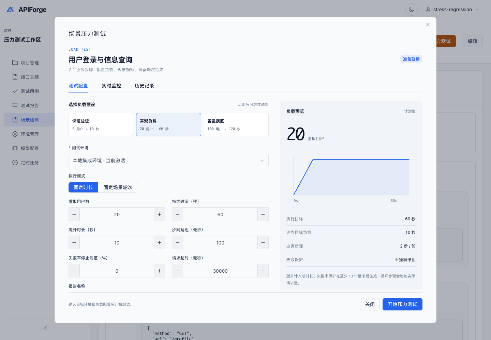

## 8. 查看、导出和对比报告

### 8.1 查看执行结果

1. 打开 **测试报告**，找到对应名称和环境的报告。
2. 点击 **查看**，先检查总用例数、通过率和耗时。
3. 展开失败或错误的用例，检查实际请求、响应及断言结果。
4. 修改用例或环境配置后重新执行，用新报告验证修复。
5. 已启用对应 AI 功能时，可点击 **AI 总结报告** 获取分析建议。

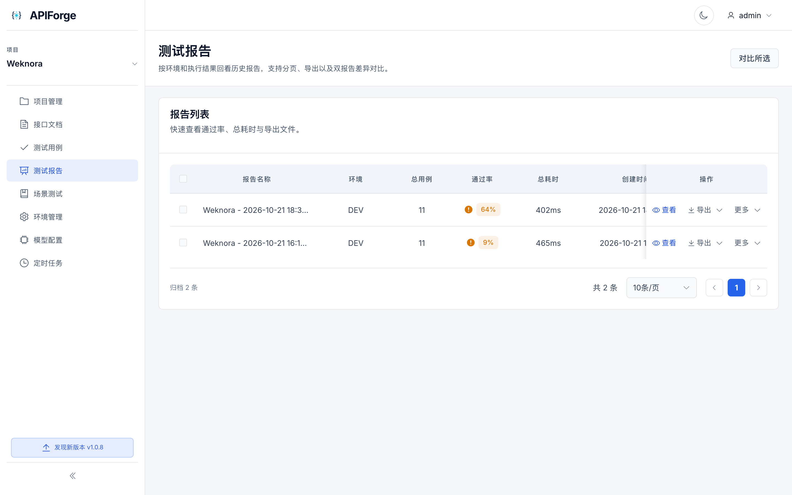

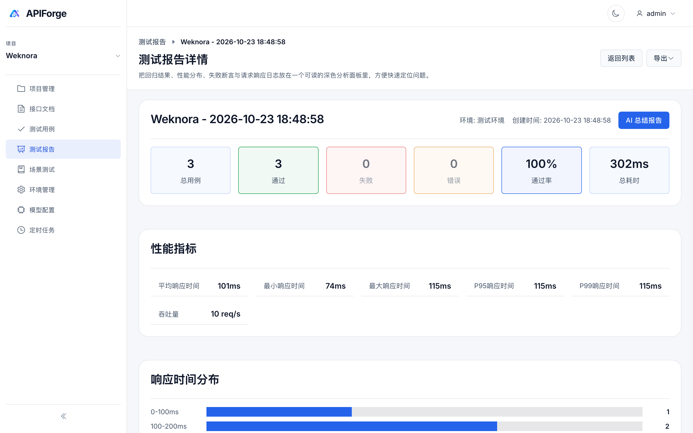

HTTP 请求返回成功不代表所有业务断言都会通过；排查时应同时检查状态码、响应字段和断言的预期值。

### 8.2 导出报告

在报告列表对应行点击 **导出**，选择 **JSON** 或 **HTML**。JSON 用于保留结构化结果，HTML 便于在浏览器中查看和分享。

### 8.3 对比两次执行

1. 在报告列表勾选两份报告。
2. 点击 **对比所选**。
3. 核对报告 A 和报告 B，查看通过率、耗时及用例状态变化。
4. 需要调整比较对象时，直接切换页面中的报告选择框。

建议选择同一业务范围、相同环境的前后两次报告，便于判断修改后的变化。

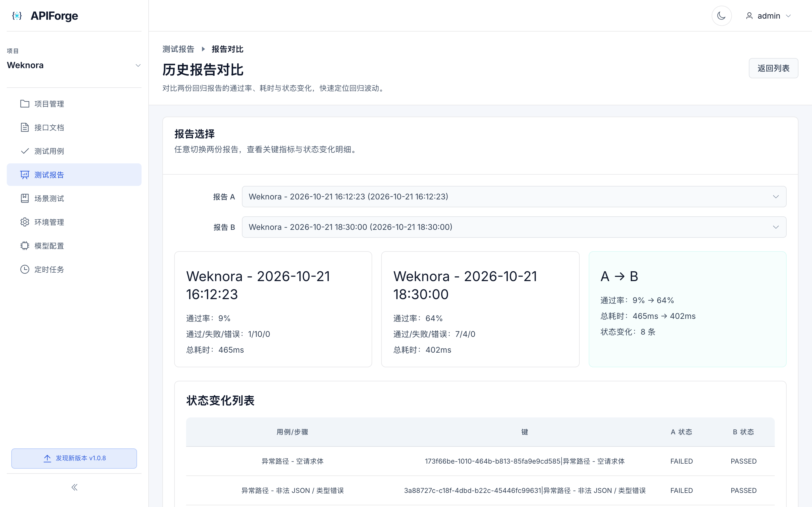

## 9. 配置 AI 模型服务

页面分 **功能与模型**、**模型列表** 两块。先加模型，再决定每项功能用哪个模型。

### 9.1 新增模型

1. 在项目菜单打开 **模型配置**，在 **模型列表** 右上角点击 **新增模型**。
2. 填写模型名称、提供商类型、API 地址、API Key 和默认模型。
3. 选择模型后，等待 **思考程度** 自动检测，只从检测到的档位中选择。不需要调整时保留默认设置；检测失败时点击 **重新检测**。服务商未提供可确认的档位时，使用模型默认值。
4. 在 **启用功能** 中勾选这个模型要承担的功能，并打开 **启用** 开关，点击 **确定**。
5. 点击 **测试连接** 做一次全量检测，确认状态列显示可用。

API 地址按所选服务的实际接口填写。编辑已有模型时，API Key 留空会保留已保存的密钥。

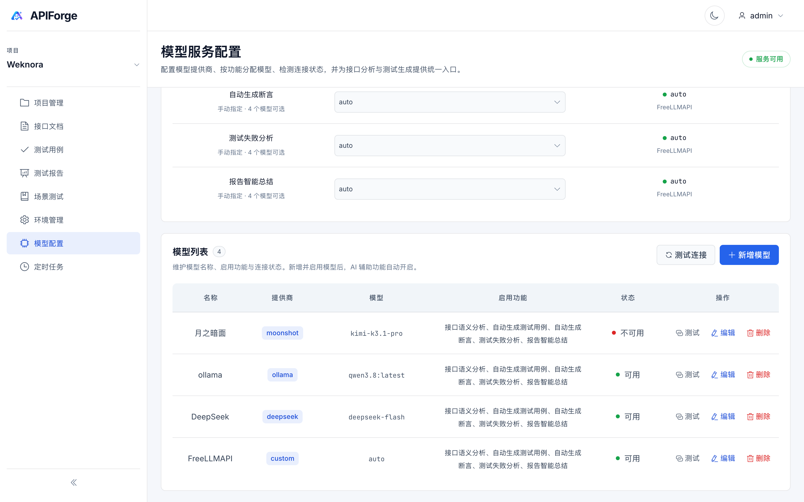

### 9.2 按功能分配模型

**功能与模型** 卡片为每个 AI 功能单独指定模型：

| 列 | 含义 |
| --- | --- |
| 功能 | 接口语义分析、自动生成测试用例、自动生成断言、测试失败分析、报告智能总结 |
| 使用的模型 | 留空为「自动选择」，由系统在承担该功能的模型里挑一个；也可以手动指定 |
| 实际生效 | 当前真正会调用的模型与提供商 |

修改下拉框即时保存，没有「保存设置」按钮。选项里只出现勾选了对应功能的模型，所以某个功能下拉为空时，先到 **模型列表** 编辑模型，补勾该功能。

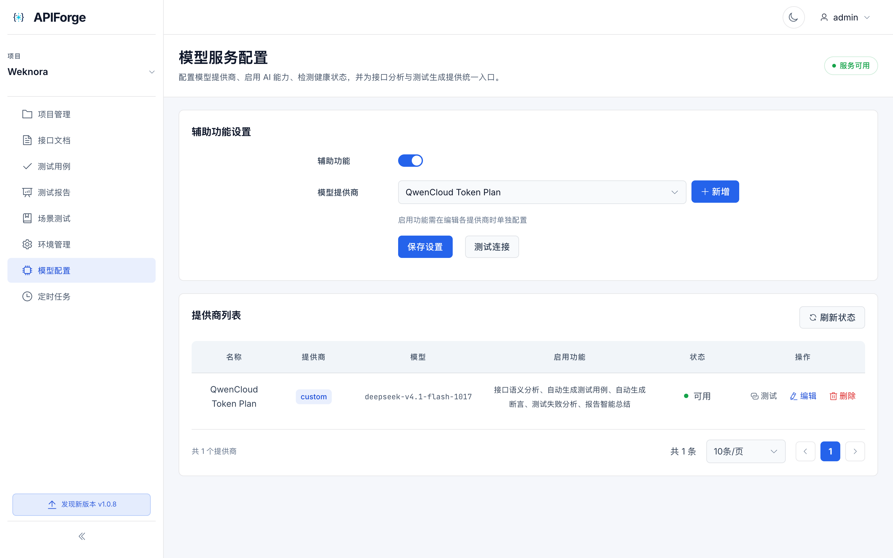

### 9.3 启用与关闭 AI

AI 能力由「是否存在已启用的模型」决定：**模型列表里至少有一个启用的模型，AI 功能就处于开启状态**；把模型全部停用即等于关闭 AI，不需要额外的总开关。

不同 AI 按钮依赖各自的功能开关。连接可用但某项功能无法使用时，编辑模型，检查是否勾选了对应的 **接口语义分析**、**自动生成测试用例**、**自动生成断言**、**测试失败分析** 或 **报告智能总结**。AI 场景编排使用 **自动生成测试用例** 功能。

## 10. 创建定时任务

先手动执行目标用例或场景，确认环境和断言正确，再配置定时执行。

1. 打开 **定时任务**，点击 **创建定时任务**。
2. 填写任务名称与 Cron 表达式。
3. 选择执行类型：**测试套件** 可选择多个用例；**场景测试** 选择一个场景。
4. 选择执行环境，设置是否 **启用**，点击 **保存**。
5. 在列表检查状态和下次执行时间。
6. 到执行时间后，检查上次执行时间，并到 **测试报告** 查看结果。

Cron 使用 `分 时 日 月 周` 五段格式，例如：

| 表达式 | 执行时间 |
| --- | --- |
| `*/5 * * * *` | 每 5 分钟 |
| `0 9 * * *` | 每天 09:00 |
| `0 9 * * 1-5` | 每周一至周五 09:00 |
| `0 0 * * *` | 每天 00:00 |

调度按后端运行环境的时区计算；项目 Docker 镜像默认使用 `Asia/Shanghai`。后端服务必须持续运行。需要暂停任务时，在列表点击 **禁用**；恢复时点击 **启用**。

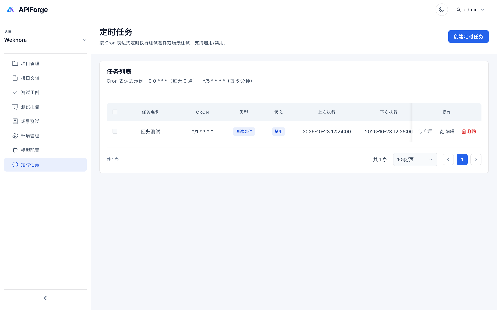

## 11. 常见问题与排查顺序

| 问题 | 排查方法 |
| --- | --- |
| 不知道初始登录密码 | 向部署人员获取首次初始化时的后端日志；已有账号不会在每次重启时重新生成密码 |
| 登录后被要求重新登录 | 使用当前密码登录；修改密码后也需重新登录 |
| 提示没有环境或执行到了错误环境 | 检查当前项目，创建并激活正确环境；场景和定时任务中另行核对所选环境 |
| 请求超时、连接拒绝或域名无法解析 | 从 APIForge 后端所在机器检查网络、端口和基础 URL；容器部署时检查容器内访问地址 |
| 提示变量未解析 | 检查变量名和大小写，确认环境变量存在；检查前置步骤是否成功及提取路径是否匹配实际响应 |
| 返回 401 或 403 | 检查前置用例、变量提取规则和 Authorization 格式，确认账号有被测接口所需权限 |
| API 导入失败 | 检查所选格式与文档是否一致；URL 需返回原始文档，上传或粘贴的内容需是有效接口定义 |
| JSON 配置无法保存 | 检查双引号、逗号和括号；Headers、Query 填对象，断言填数组 |
| 状态码正确但用例失败 | 对照每条断言的实际值和预期值，检查 JSON 路径、值类型及响应时间阈值 |
| AI 不可用或按钮禁用 | 检查模型列表中是否至少有一个启用的模型、该模型是否勾选了对应功能、API 地址 / Key / 模型是否正确，再点 **测试连接** |
| 执行后报告列表没有记录 | 单用例执行不自动保存为报告；使用一键执行，或在场景执行时开启生成报告 |
| 定时任务没有按预期执行 | 检查任务是否启用、Cron、后端时区、下次执行时间及服务是否持续运行；再检查后端执行日志 |
| 点「更新」后只下载了镜像，容器没变 | 先看提示：更新失败会直接给出原因。仍无进展时查看 `docker logs apiforge-updater` 和 `<数据卷>/update.log`；详见《Docker 构建与推送》的「一键更新排查」 |
| 提示「无法连接 Docker」 | 容器启动时没有挂载 `-v /var/run/docker.sock:/var/run/docker.sock`，需重建容器并保留该参数 |

需要进一步定位时，请记录项目名称、环境、用例或场景名称、执行时间、错误提示及相关报告，并让部署人员检查同一时间的后端日志。
